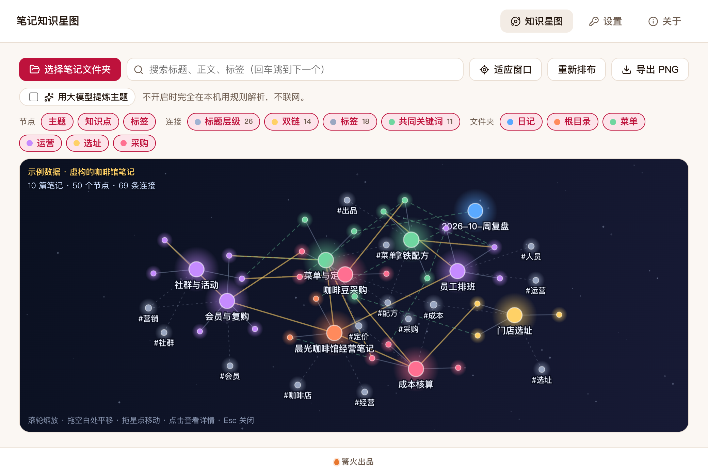

# 笔记知识星图

> 篝火出品 · 收录于篝火 App 应用区

导入自己的笔记，生成能点能拖的知识星空图，看清知识之间的联系



## 下载

到 [Releases](https://github.com/campfire-code/notes-star-map/releases/latest) 下载对应安装包：

| 电脑 | 文件 |
|---|---|
| Windows 10 / 11 | `notes-star-map_版本号_windows-x64-setup.exe` |
| Mac（Apple 芯片） | `notes-star-map_版本号_mac-arm64.dmg` |
| Mac（Intel 芯片） | `notes-star-map_版本号_mac-x64.dmg` |

第一次打开：
- **Windows**：如果弹出「Windows 已保护你的电脑」，点「更多信息」→「仍要运行」。
- **Mac**：如果提示「无法验证开发者」，打开「系统设置 → 隐私与安全性」，在下方点「仍要打开」。

## 怎么用

**生成星图**
1. 打开后默认显示一套虚构的「咖啡店经营」示例笔记（左上角标着「示例数据」），可以先随便点点看。
2. 点「选择笔记文件夹」，选你存 `.md` / `.txt` 笔记的文件夹（Obsidian 库也行）。会读取其中 3 层以内的子文件夹，跳过以 `.` 开头的隐藏文件夹；单个文件超过 2 MB 或总数超过 2000 个会跳过并提示。笔记**只在本机读取和解析，不会修改，也不会上传**。
3. 几秒内出现星图：大圆是「主题」（每篇笔记一个），中圆是「知识点」（笔记里的各级标题），灰色小圆是「标签」；颜色按第一级文件夹区分。

**星图是怎么连起来的**（全部是本地规则）
- **标题层级**：笔记连到它的一级标题，标题再连到下级标题。第一个 `# 一级标题` 当作笔记标题。
- **双链**：`[[笔记名]]`、`[[笔记名|别名]]` 按笔记文件名或标题匹配；`[[笔记名#小节]]` 直接连到那个小节。找不到对应笔记的双链会在左上角提示个数。
- **标签**：`#标签`、front matter 里的 `tags:`；`#项目/咖啡` 这样的层级标签会连到上级标签。代码块和链接里的 `#` 不算。
- **共同关键词**：不同笔记里的两个节点，共有至少 2 个关键词才连；每个节点最多保留 3 条最强的，避免连成一团。关键词按词频和稀有程度提取，只出现一次的零碎词、出现在一半以上笔记里的泛词都会去掉。中文分词用系统自带的分词器，不同系统的分词结果可能略有差别。
- `.txt` 文件不拆标题，整篇算一个主题。

**操作**
- 滚轮缩放（以鼠标位置为中心）、拖空白处平移、拖星点移动位置；鼠标移到星点上，它在原位放大，相邻节点轻微放大并高亮连线。
- 点星点：屏幕中央弹出详情，含摘要、关键词、出处（文件、行号、原文片段，可「在文件夹中显示」）和相邻节点（点一下跳过去）。右上角 × 或按 Esc 关闭。
- 搜索：搜标题、正文、标签，不匹配的淡化，回车依次跳到命中项。点详情里的关键词会直接搜它。
- 筛选：按节点类型、连接类型、第一级文件夹显示或隐藏。
- 适应窗口 / 重新排布；导出 PNG 会把当前筛选后的全部节点画成 3200×2000 的图（固定深色星空底）。

**可选：用大模型提炼主题**
1. 在「设置」里填接口地址、密钥和模型名（兼容 OpenAI 接口格式）。密钥只保存在本机。
2. 勾选主界面的「用大模型提炼主题」，再读取文件夹。每篇笔记（最多 80 篇）的前 2500 字会发给你填写的接口，让模型给出主题名、一句话摘要和关键词；同名主题合并成一个金色的主题节点，连到各笔记。单篇失败时该篇沿用本地规则。
3. 不勾选或没填模型时，完全不联网。

## 验收用例

用 `samples/咖啡店经营示例/` 里的 10 个示例文件（内容虚构）：

| 操作 | 应得到 |
|---|---|
| 打开工具，不做任何操作 | 画布左上角显示「示例数据 · 虚构的咖啡馆笔记」和「10 篇笔记 · 50 个节点 · 69 条连接」；连接统计为标题层级 26、双链 14、标签 18、共同关键词 11 |
| 点「选择笔记文件夹」，选 `samples/咖啡店经营示例` | 提示「读取了 10 篇笔记」，统计与上一行相同；文件夹筛选出现 日记、根目录、菜单、运营、选址、采购 |
| 鼠标移到「员工排班」大圆上，再点一下 | 圆在原位放大；点击后中央弹出详情：「主题 · 运营」，出处 `运营/员工排班.md`，相邻节点含「高峰时段」「培训清单」「交接班」「晨光咖啡馆经营笔记」（双链）；按 Esc 关闭 |
| 搜索框输入 `损耗` | 右侧显示「8 个」；「损耗控制」「牛奶打发」「交接班」等 8 个节点高亮，其余淡化；按回车画面跳到第一个命中项 |
| 关掉「标签」节点类型 | 灰色 `#标签` 节点和标签连线消失，其余不变 |
| 点「导出 PNG」，保存为任意文件 | 得到 3200×2000 的深色星空图，右下角注明「示例数据」 |
| 把窗口缩放到 125%、或在高分屏与普通屏之间拖动窗口 | 鼠标放到任一星点圆心，都应悬停到那一颗（自动化脚本在 1、1.25、2 倍屏下对 25 个节点逐个验证过） |

## 风险与限制

- 只读取你选的文件夹，不改动、不上传笔记；只有开启「用大模型提炼主题」时，笔记内容才会发给你自己填写的模型接口。
- 节点超过 500 个时，先丢掉内容最少的知识点；笔记很多时请先用文件夹筛选。
- 不解析 `.docx`、图片、PDF；不识别 Obsidian 的嵌入 `![[...]]` 与别名文件。
- 关键词和连接是规则结果，只表示「文字上相关」，不等于语义上一定相关。

## 验收用例

<!-- 用 samples/ 里的示例文件按步骤操作，应得到的结果 -->

## 自己编译

需要 Node.js 22、pnpm、Rust。

```bash
pnpm install
pnpm test          # 单元测试
pnpm tauri dev     # 开发运行
pnpm tauri build   # 打包
```

界面框架在 `src/kit`（所有 campfire-code 工具共用），本工具的逻辑在 `src/tool`。

## 归属

本工具由**篝火**出品，是篝火 App 应用区收录的开源工具之一，由篝火（GitHub 组织 [campfire-code](https://github.com/campfire-code)）维护与更新。全部工具的目录见 [toolkit-hub](https://github.com/campfire-code/toolkit-hub)。

## 许可证

MIT，版权方为篝火（campfire-code）。
